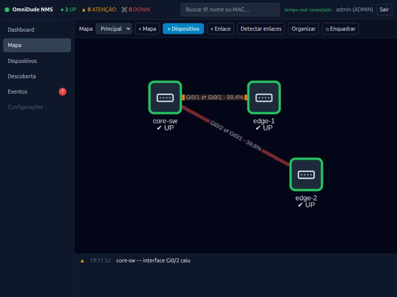
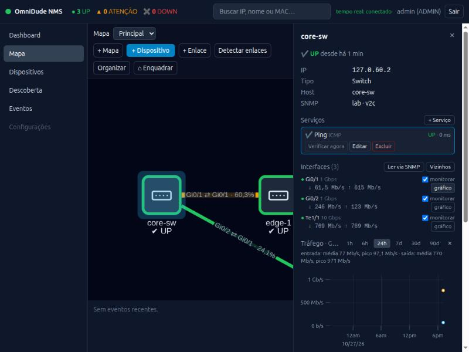
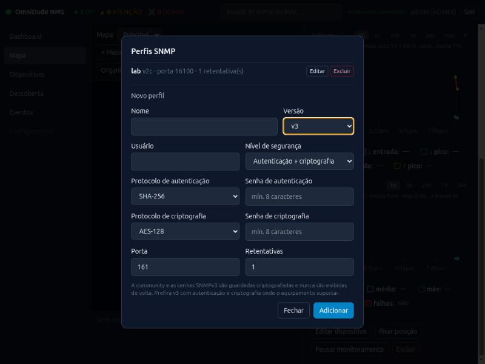
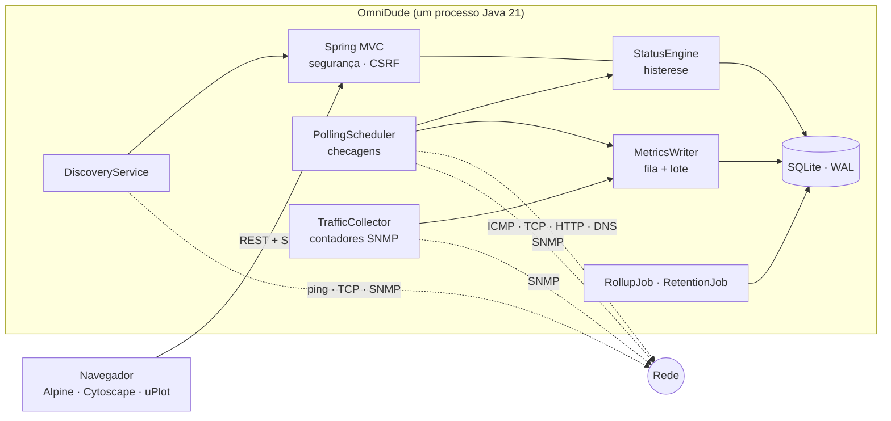

<h1 align="center">OmniDude NMS</h1>

<p align="center">
  Monitoramento de rede em um único <code>.jar</code>: mapa interativo, descoberta automática, checagens com histerese,
  tráfego por interface e eventos em tempo real. Inspirado no The Dude, sem agentes e sem banco externo.
</p>

<p align="center">
  
  
  
  
  
  
</p>

<p align="center">
  <a href="https://rbiasibetti.github.io/OmniDude/">Manual</a> ·
  <a href="#início-rápido">Início rápido</a> ·
  <a href="#funcionalidades">Funcionalidades</a> ·
  <a href="#configuração">Configuração</a> ·
  <a href="#api-rest">API</a> ·
  <a href="#arquitetura">Arquitetura</a> ·
  <a href="#segurança">Segurança</a> ·
  <a href="#desenvolvimento">Desenvolvimento</a> ·
  <a href="PLANO_IMPLEMENTACAO.md">Plano</a>
</p>



> **Estado do projeto:** em desenvolvimento ativo. As fases 0 a 4 do [plano de implementação](PLANO_IMPLEMENTACAO.md)
> estão prontas, além das notificações, da tela de configurações, da gestão de usuários, do backup e do modo de manutenção (Fase 5). Da Fase 6 estão prontos a [revisão de segurança](SEGURANCA.md) e o
> [serviço systemd](INSTALL.md); o teste de carga e o Dockerfile ficam para depois.
> Veja as [limitações conhecidas](#limitações-conhecidas) antes de usar em produção.

## Sumário

- [Manual ilustrado](#manual-ilustrado)
- [Por que o OmniDude](#por-que-o-omnidude)
- [Funcionalidades](#funcionalidades)
- [Início rápido](#início-rápido)
- [Configuração](#configuração)
- [Uso](#uso)
- [API REST](#api-rest)
- [Arquitetura](#arquitetura)
- [Segurança](#segurança)
- [Desenvolvimento](#desenvolvimento)
- [Limitações conhecidas](#limitações-conhecidas)
- [Roadmap](#roadmap)
- [Contribuindo](#contribuindo)
- [Licença](#licença)
- [Créditos](#créditos)

## Manual ilustrado

<https://rbiasibetti.github.io/OmniDude/>

## Por que o OmniDude

O The Dude é ótimo para ver uma rede pequena ou média num mapa, mas é fechado, só roda bem no Windows/RouterOS e não se
integra a nada. O OmniDude mantém a ideia (cadastre ou descubra os equipamentos, arraste-os num mapa, veja o que está
verde ou vermelho) com uma base moderna e simples de operar:

- **Um arquivo, um processo.** Spring Boot com SQLite embutido; sem servidor de banco, sem fila, sem agentes nos
  equipamentos. Precisa só de JRE 21.
- **Barato de rodar.** Threads virtuais e uma única thread de escrita em lote no banco (SQLite em WAL) sustentam
  centenas de equipamentos numa máquina modesta.
- **Interface sem etapa de build.** SPA estática (Alpine.js, Cytoscape.js, uPlot e Tailwind já compilado); todas as
  bibliotecas são servidas localmente, nada vem de CDN.
- **Seguro por padrão.** Escuta só em `127.0.0.1`, segredos cifrados com AES-256-GCM, CSRF, e a descoberta recusa redes
  públicas e exige autorização explícita.

## Funcionalidades

| Área | O que faz |
|---|---|
| **Mapa** | Nós arrastáveis com posição persistida, vários mapas, layout automático, busca por IP, nome, MAC ou fabricante, atualização em tempo real por SSE, **publicação pública somente leitura** |
| **Checagens** | ICMP, TCP, HTTP/HTTPS, DNS e SNMP; estado com histerese (*N* falhas para cair, *M* sucessos para voltar); dispositivo DOWN suprime os alertas dos serviços dele |
| **Latência** | Gráfico por serviço (1 h a 30 d), disponibilidade, média e máximo |
| **Descoberta** | Varredura de faixa CIDR (ping + portas TCP + SNMP), identificação por regras (`fingerprints.yml`) e pelo **fabricante do MAC** (tabela OUI do IEEE), revisão e importação em 3 passos |
| **Topologia** | Vizinhos anunciados (LLDP, CDP, MNDP), tabelas de encaminhamento (FDB) e ARP dos equipamentos SNMP, nós para switch/hub sem SNMP e enlaces inferidos, cada um com sua origem e a evidência; você confirma ou descarta |
| **Tráfego** | Contadores de 64 bits por interface, taxa Rx/Tx com tratamento de *wrap* e *reset*, erros, estado operacional; cor e espessura do enlace pela utilização; gráficos de 1 h a 90 d |
| **SNMP** | v1, v2c e **v3 (USM)**: `noAuthNoPriv`, `authNoPriv` e `authPriv` com SHA, SHA-256, SHA-512 e AES-128/192/256 |
| **Eventos** | Queda e recuperação de dispositivos e serviços, interface de enlace que cai ou volta, descoberta; confirmação (*ack*) |
| **Notificações** | Canais **e-mail (SMTP)**, **Telegram** e **webhook** (assinado com HMAC), regras por gravidade, tipo de evento e dispositivo, aviso de recuperação, histórico de envios, teste de canal, anti-repetição e limite por minuto |
| **Administração** | Tela de **Configurações** (só `ADMIN`): ajustes em tempo de execução, **modo de manutenção** global (suspende notificações), **usuários** (criar, perfil, ativar, redefinir senha, apagar) e **backups** do banco |
| **Dashboard** | Contagens por estado, problemas ativos, maiores latências, últimos eventos |
| **Retenção** | Amostras brutas por 7 dias, agregado horário por 400 dias, agregação automática antes da limpeza |
| **Identidade (DHCP)** | O dispositivo é reconhecido pelos **MACs**, não pelo IP: se o DHCP muda o endereço, o OmniDude acha o MAC no ARP e atualiza o IP (com histórico, checagens e enlaces preservados); avisa quando outra máquina assume o IP de um dispositivo; a descoberta oferece "Atualizar IP" em vez de criar um duplicado |
| **Acesso** | Login com sessão, perfis `ADMIN` (altera) e `VIEWER` (só lê), bloqueio por tentativas, troca de senha obrigatória, sessões derrubadas quando o acesso do usuário muda |

## Início rápido

### Requisitos

- **JDK 21** para compilar e **JRE 21** para executar.
- Maven 3.9 ou superior para compilar.
- O utilitário `ping` no `PATH` (as checagens ICMP usam o `ping` do sistema operacional, sem exigir privilégio de root).
- Linux, macOS ou Windows. O ICMP só foi validado em Linux (veja [limitações](#limitações-conhecidas)).

### Compilar e executar

```bash
git clone <url-do-repositório> omnidude
cd omnidude
mvn clean package
java -jar target/omnidude-0.1.0-SNAPSHOT.jar
```

Abra <http://127.0.0.1:8080>.

No **primeiro acesso** o usuário é `admin` e a senha é gerada aleatoriamente e mostrada **uma única vez** no log de
inicialização. O sistema exige a troca dessa senha no primeiro login. Para definir a senha inicial e dispensar a troca
(úteis em laboratório e automação):

```bash
OMNIDUDE_ADMIN_PASSWORD='uma-senha-forte' java -jar target/omnidude-0.1.0-SNAPSHOT.jar
```

### Primeiros passos na interface

1. **Descoberta** → informe uma faixa (ex.: `192.168.1.0/24`), marque que você tem autorização para varrer a rede e
   escolha os perfis SNMP a tentar. Revise o resultado e importe.
2. Ou **Mapa → + Dispositivo** para cadastrar à mão.
3. Cadastre um **perfil SNMP** (botão **Perfis…** no formulário do dispositivo) e associe-o aos equipamentos; em seguida use
   **Ler via SNMP** no inspetor para trazer as interfaces e **Detectar enlaces** para o LLDP.
4. Marque **monitorar** nas interfaces cujo tráfego você quer ver. A primeira taxa aparece na segunda leitura
   (por padrão, ~1 minuto).

> Use o OmniDude apenas em redes próprias ou autorizadas.

### Instalar como serviço (systemd)

Para um servidor Linux, a unidade endurecida (usuário próprio, dados privados, sistema de arquivos somente leitura,
só `CAP_NET_RAW`) fica em [`packaging/`](packaging/):

```bash
mvn clean package
sudo ./packaging/install.sh --start
journalctl -u omnidude -f
```

Detalhes, proxy reverso com HTTPS, atualização e remoção em [INSTALL.md](INSTALL.md).

## Configuração

### Variáveis de ambiente

| Variável | Padrão | Função |
|---|---|---|
| `OMNIDUDE_DATA_DIR` | `./data` | Onde ficam `omnidude.db` e `secret.key`. **Faça backup dos dois.** |
| `OMNIDUDE_BIND` | `127.0.0.1` | Endereço de escuta: `127.0.0.1` (só a própria máquina), `0.0.0.0` (todas as interfaces) ou o IP de uma interface. Fora de `127.0.0.1`, prefira TLS ou proxy (veja abaixo) |
| `OMNIDUDE_PORT` | `8080` | Porta HTTP |
| `OMNIDUDE_SECRET_KEY` | (arquivo) | Chave AES-256 em base64 (32 bytes). Sem ela, é gerada em `secret.key` |
| `OMNIDUDE_ADMIN_PASSWORD` | (aleatória) | Senha inicial do `admin`; dispensa a troca obrigatória |
| `OMNIDUDE_FORWARD_HEADERS` | `none` | Atrás de proxy reverso, use `native` (confia em `X-Forwarded-*` só dos proxies abaixo). Evite `framework` |
| `OMNIDUDE_TRUSTED_PROXIES` | só a própria máquina | Expressão regular dos IPs de proxy confiáveis |
| `OMNIDUDE_COOKIE_SECURE` | `false` | `true` com HTTPS (proxy ou TLS próprio): o cookie de sessão só trafega por TLS. Com HTTP puro, deixe `false` |
| `SERVER_SSL_ENABLED`, `SERVER_SSL_KEY_STORE`, `SERVER_SSL_KEY_STORE_PASSWORD`, `SERVER_SSL_KEY_STORE_TYPE` | desligado | TLS no próprio OmniDude, com certificado PKCS12 (`PKCS12`) |

#### Acessar pelo IP da máquina

Há três opções, da mais simples à mais indicada:

1. **HTTP na rede.** `OMNIDUDE_BIND=0.0.0.0` e abra `http://IP-DA-MAQUINA:8080`. Libere a porta no firewall. A senha e a
   sessão trafegam **sem criptografia** (o log avisa): só em rede interna confiável. Não ligue `OMNIDUDE_COOKIE_SECURE`.
2. **TLS no próprio OmniDude.** `OMNIDUDE_BIND=0.0.0.0` com `SERVER_SSL_*` apontando para um `.p12` e
   `OMNIDUDE_COOKIE_SECURE=true`; acesse `https://IP-DA-MAQUINA:8443`.
3. **Proxy reverso com HTTPS** (recomendada): mantenha `127.0.0.1` e use `OMNIDUDE_FORWARD_HEADERS=native`.

Passo a passo, exemplos de firewall, `keytool` e nginx em [INSTALL.md](INSTALL.md) e no
[manual](https://rbiasibetti.github.io/OmniDude/instalacao.html).

> `secret.key` cifra as credenciais SNMP guardadas no banco. Sem a chave, os perfis SNMP existentes ficam
> inutilizáveis: copie-a junto com o banco.

### Propriedades

Alguns valores também se editam **em tempo de execução**, em *Configurações → Ajustes e manutenção* (retenção, intervalo de coleta de tráfego, padrões de checagem nova, limites da descoberta, anti-repetição, backup): o valor da tela vence o desta tabela, e "restaurar padrão" volta a ele.

Qualquer propriedade pode ser passada na linha de comando (`java -jar omnidude.jar --omnidude.traffic.interval-s=30`)
ou num `application.yml` ao lado do jar. Os valores padrão estão em
[`application.yml`](src/main/resources/application.yml).

| Propriedade | Padrão | Função |
|---|---|---|
| `omnidude.monitoring.max-concurrent-checks` | `200` | Checagens simultâneas |
| `omnidude.monitoring.default-interval-s` / `default-timeout-ms` | `30` / `2000` | Valores de uma checagem nova |
| `omnidude.traffic.enabled` | `true` | Liga a coleta de tráfego |
| `omnidude.traffic.interval-s` | `60` | Intervalo da coleta de contadores por dispositivo |
| `omnidude.traffic.max-concurrent` | `32` | Dispositivos consultados ao mesmo tempo |
| `omnidude.retention.raw-days` | `7` | Dias de amostras brutas |
| `omnidude.retention.hourly-days` | `400` | Dias de agregado horário |
| `omnidude.discovery.max-hosts` | `4096` | Acima disso a varredura pede confirmação |
| `omnidude.discovery.hard-max-hosts` | `65536` | Teto absoluto |
| `omnidude.discovery.concurrency` / `rate-per-second` | `128` / `200` | Sondas simultâneas e hosts iniciados por segundo |
| `omnidude.discovery.allow-public` | `false` | Permite varrer faixas públicas |
| `omnidude.discovery.default-ports` | `22, 80, 443, 3389` | Portas TCP sondadas na varredura |
| `omnidude.discovery.passive` | `true` | Consulta NetBIOS, SSDP/UPnP e mDNS em cada host encontrado |

## Uso

### Mapa e dispositivos

Arraste os nós para posicioná-los (a posição é gravada); **Fixar posição** impede que o **Organizar** (layout
automático) mova o nó. Clique num nó para abrir o **inspetor**: serviços, interfaces, gráficos e ações. Um dispositivo em
manutenção (**Pausar monitoramento**) não é checado e não gera alertas.

### Checagens

Todo dispositivo recebe um **Ping** ao ser criado; outros serviços entram por **+ Serviço** no inspetor.

| Tipo | O que testa | Parâmetros |
|---|---|---|
| ICMP | Resposta ao `ping` do SO | — |
| TCP | Conexão na porta | porta |
| HTTP / HTTPS | Resposta do serviço (sem seguir redirecionamentos) | caminho, método, status aceitos, texto esperado, verificar TLS |
| DNS | O dispositivo, como servidor DNS, responde `NOERROR` com registros | nome, tipo de registro |
| SNMP | `sysUpTime` via SNMP, com o perfil do dispositivo | — |

Um serviço só vira DOWN após *N* falhas seguidas (padrão 3) e só volta a UP após *M* sucessos (padrão 1). Com o
dispositivo DOWN, apenas a checagem âncora (ICMP, ou SNMP na falta dela) continua e as falhas de serviço não geram
eventos.

### Descoberta

Varre uma faixa CIDR (ping e portas TCP em paralelo), consulta por SNMP quem responde e identifica o equipamento pelo
`sysObjectID`, `sysDescr` e portas abertas. Você revisa nome e tipo antes de importar; hosts já cadastrados não são
sondados de novo.

- Só redes privadas, loopback, link-local e CGNAT; faixa pública exige `omnidude.discovery.allow-public=true`.
- Faixas acima de 4.096 endereços pedem confirmação; o teto é 65.536. Um job por vez, cancelável, com progresso ao vivo.
- Em cada host encontrado, a descoberta também consulta **NetBIOS** (nome e grupo; típico de Windows e Samba), **SSDP/UPnP**
  (fabricante, modelo e tipo; roteadores respondem como `InternetGatewayDevice`) e **mDNS** (nome `.local` de Apple, Linux e
  impressoras), em unicast. O nome vira o nome sugerido quando não há SNMP, e o texto aparece na revisão. Desligue com
  `omnidude.discovery.passive=false`.
- Para personalizar a identificação de equipamentos, crie `fingerprints.yml` no diretório de dados: as regras dele vêm
  antes das embutidas (veja [`fingerprints.yml`](src/main/resources/fingerprints.yml)).

**Fabricante pelo MAC.** O prefixo do MAC (OUI) é consultado nas tabelas do [arp-scan](https://github.com/royhills/arp-scan)
(`ieee-oui.txt`, com os blocos de 24, 28 e 36 bits do registro IEEE, e `mac-vendor.txt`), embutidas em
[`src/main/resources/oui`](src/main/resources/oui). O fabricante aparece na revisão da descoberta, no inspetor e na lista
de dispositivos, e a busca do cabeçalho também o encontra. Ele entra na identificação por regras (`vendor:` em
`fingerprints.yml`): serve de palpite quando não há SNMP nem portas, e refina o que o SNMP não separa (por exemplo, um
Linux de fabricante Ubiquiti é ponto de acesso, e de fabricante Synology é storage). As regras só por fabricante vêm
depois de todas as outras e cobrem apenas fabricantes de tipo quase sempre único. Limites:

- O MAC só é conhecido para hosts na mesma rede local (tabela ARP do servidor) ou depois de **Ler via SNMP**
  (MAC das interfaces). Atrás de um roteador, o host não tem fabricante.
- MAC aleatório (celulares) e virtual tem o bit "administrado localmente" ligado: nesse caso a interface mostra
  "MAC aleatório/virtual" em vez de arriscar um fabricante.
- Para acrescentar ou corrigir prefixos sem recompilar, crie `mac-vendor.txt` no diretório de dados (uma linha por
  prefixo: `<prefixo hex><TAB><fabricante>`, de 1 a 12 dígitos); as linhas dele vencem as embutidas.

### Topologia

**Detectar enlaces** lê, de cada equipamento SNMP, os vizinhos anunciados, a tabela de encaminhamento (FDB), a tabela ARP,
e propõe enlaces. Tudo entra como **sugestão** (tracejado), com a origem e o motivo no enlace (clique nele); você confirma,
ajusta as interfaces ou descarta, e um enlace descartado não volta. **Confirmar sugeridos** confirma todos de uma vez.
**Vizinhos**, no inspetor, lê só os anúncios de um equipamento.

**Enlaces manuais.** Use **+ Enlace** e clique nos dois dispositivos do mapa, ou **Ligar a…** no inspetor para escolher origem
e destino numa lista (inclusive dispositivos que não estão visíveis). Cada enlace pode ter interfaces, um rótulo e um
**tipo**: Cabo, Wi-Fi, VPN, Internet/WAN ou Outro (VPN, Internet e Wi-Fi têm traço próprio e aparecem no rótulo). Enlaces
manuais nascem confirmados e nunca são alterados pela detecção.

**Dispositivos externos.** DNS público, o roteador de uma filial ou qualquer IP fora da rede são dispositivos comuns: cadastre
com o IP, adicione as checagens (ICMP, DNS, TCP…) e ligue com um enlace manual. Para o que **não tem endereço a monitorar**
(Internet, uma VPN, a nuvem, um segmento de rede), marque **Nó lógico** ao criar o dispositivo: ele aparece no mapa (nuvem tracejada), sem IP, sem
checagens e fora das contagens, só para receber enlaces. A detecção automática não os apaga nem liga nada a eles.

Tipos de dispositivo: roteador, switch, firewall, access point, servidor, estação, impressora, storage, **nuvem**, **rede** e
outro. Nuvem e rede servem para o que está além dos equipamentos (Internet, serviços em nuvem, VLANs e sub-redes) e valem
tanto para nós lógicos quanto para dispositivos com IP; um nó lógico sem tipo vira nuvem.

| Origem | Evidência | Confiança |
|---|---|---|
| `LLDP`, `CDP`, `MNDP` | O próprio equipamento anuncia quem está do outro lado de cada porta | Alta |
| `FDB` | A porta de um switch aprendeu o MAC de um dispositivo (único MAC = host direto; MAC de outro switch que cobre os demais = enlace entre switches) | Média a alta |
| `INFERRED` | Suposição por falta de dados (traço pontilhado cinza) | Baixa |

Como a dedução funciona (cada porta de cada switch com FDB):

1. Outro switch com FDB que enxerga todos os demais da porta é o vizinho direto, e o enlace liga as duas portas.
2. Um único roteador, firewall ou AP sem FDB na porta é o vizinho direto; os outros dispositivos da porta ficam **atrás
   dele** (enlace `INFERRED`: sem SNMP não há como saber se é cabo ou Wi-Fi).
3. Um único MAC conhecido é um host ligado direto.
4. Vários MACs sem vizinho que os explique indicam um switch, hub ou AP **sem SNMP** no meio: o OmniDude cria um **nó
   virtual** (nuvem tracejada) ligado à porta e aos dispositivos que estão atrás dele.
5. O que continuar sem nenhum enlace e estiver na rede do gateway do servidor é ligado a ele (`INFERRED`). O gateway vem de
   `/proc/net/route` (Linux); fora do Linux, só se houver um único roteador ou firewall cadastrado. Gateway não cadastrado
   é avisado, não adivinhado.

A tabela ARP dos roteadores (e a do próprio servidor) completa o MAC que faltava nos dispositivos e informa hosts que ainda
não estão no inventário. Uma rodada completa também remove as sugestões automáticas que não foram reencontradas (host que
mudou de porta, nó virtual que sumiu); se alguma leitura falhar, nada é removido. Enlaces confirmados nunca são tocados.

Limites: a FDB só é lida no contexto padrão do agente (a Cisco com `community@vlan` por VLAN não é lida); um roteador
doméstico sem SNMP, sem API e sem LLDP não revela quem está no Wi-Fi ou no cabo, só dá para inferir; os OIDs de CDP e MNDP
seguem as MIBs publicadas e só foram testados contra agentes simulados.

### Notificações

*Configurações → Notificações* (só `ADMIN`). Um **canal** diz para onde enviar; uma **regra** diz o que cada canal recebe.

| Canal | Configuração | Observações |
|---|---|---|
| Webhook | URL; segredo opcional | `POST` de um JSON (`source`, `eventId`, `ts`, `severity`, `type`, `deviceId`, `deviceName`, `message`). Com segredo, o corpo vai assinado em `X-OmniDude-Signature: sha256=<hmac>`. Não segue redirecionamentos |
| Telegram | token do bot, chat (id numérico ou `@canal`), endereço da API opcional | O token vai na URL da API do Telegram: nenhuma mensagem de erro a repete |
| E-mail | servidor, porta, segurança (STARTTLS, SSL ou nenhuma), remetente, destinatários, usuário e senha opcionais | Texto simples em UTF-8; STARTTLS é exigido (nunca cai para texto puro sem avisar) |

- **Regras:** gravidade mínima, tipos de evento (nenhum marcado = todos) e dispositivo (ou todos). *Avisar da recuperação*:
  "voltou" é informativo, então, com a opção ligada, ele segue o filtro de tipo e de dispositivo em vez do de gravidade
  (senão uma regra "atenção ou pior" avisaria da queda e nunca da volta). Um canal com duas regras que casam recebe uma
  mensagem só.
- **Confiabilidade:** o envio é assíncrono (não atrasa a checagem que gerou o evento), com até 3 tentativas para falha de
  rede, 5xx ou 429; erro de configuração (4xx, senha recusada) não é repetido. Cada resultado final fica no **histórico**
  (30 dias): enviada, falhou (com o motivo), suprimida ou teste.
- **Anti-ruído:** a mesma mensagem não vai duas vezes ao mesmo canal dentro de uma janela (60 s por padrão); no máximo 30
  mensagens por minuto por canal (o excedente é registrado como suprimido); e o **modo de manutenção** suspende tudo.
- **Segredos:** a configuração do canal é um JSON criptografado (AES-256-GCM) no banco; a API devolve só os campos não secretos
  e se cada segredo existe, e editar com o segredo em branco mantém o atual.

### Identidade estável com DHCP

O IP é um atributo que muda; a identidade vem dos **MACs conhecidos** de cada dispositivo (inspetor → *Identidade*). Eles são
aprendidos sozinhos: do cadastro e da descoberta, do ARP enquanto o dispositivo responde e, nos equipamentos SNMP, de
todas as interfaces. Dá para acrescentar outro à mão (a placa Wi-Fi de um notebook, por exemplo).

**O que acontece a cada minuto** (com o ARP do servidor e, a cada 10 min, o dos roteadores e firewalls SNMP):

| Situação | Resultado |
|---|---|
| Dispositivo **DOWN**, e o MAC dele aparece em outro IP que ninguém usa | O IP é **atualizado sozinho**, com histórico, e um evento informa. Checagens, enlaces, posição no mapa e gráficos continuam os mesmos |
| O MAC responde nos **dois** IPs | O novo vira endereço adicional (equipamento com duas interfaces) |
| Dispositivo ainda **UP** no IP antigo | Nada: espera (o ARP antigo pode só estar velho) |
| O IP de um dispositivo é visto com **outro MAC** | **Aviso** (uma vez): outra máquina pode ter assumido o endereço, e o dispositivo pode estar "UP" por engano. Se a placa foi trocada, adicione o MAC novo no inspetor |
| MAC **aleatório** (celular com endereço privado), de VM ou de mais de um dispositivo | Nunca decide sozinho |

- **Achar um IP que ninguém contatou:** com dispositivos DOWN que têm MAC estável, o OmniDude faz o kernel resolver o ARP da
  sub-rede deles (um byte UDP para a porta 9 de cada endereço; sem privilégio, no máximo a cada 5 min por sub-rede). Só vale
  para sub-redes em que o servidor tem interface, privadas e de até 1.024 endereços; fora disso só o ARP dos roteadores
  SNMP ajuda. **Procurar novo IP** (inspetor, dispositivo DOWN) faz a busca na hora.
- **Descoberta:** um host que tem o MAC (ou, como sugestão, o nome) de um dispositivo cadastrado com outro IP aparece como
  "Parece ser *X* (cadastrado com *Y*)" com o botão **Atualizar IP**; "Selecionar todos" o deixa de fora e importá-lo
  como novo exige marcá-lo de propósito.
- **Ajustes** (*Identidade (DHCP)*): desligar a atualização automática (só avisa) e o intervalo de leitura do ARP dos roteadores.
- **Limites:** sem o ARP não há identidade nova: dispositivos atrás de um roteador sem SNMP, em outra rede, não são
  reconhecidos. Celulares com MAC aleatório só entram por sugestão de nome. A melhor fonte seria o servidor DHCP (concessões
  e reservas), ainda não lida; para o que importa (servidores, switches, impressoras), **reserve o IP no DHCP**.

### Manutenção, usuários e backup

- **Modo de manutenção** (*Ajustes e manutenção*): liga por 30 min, 1 h, 4 h ou até você desligar; o prazo expira sozinho.
  Eventos e checagens seguem normais, só as notificações param, e **todos** os usuários veem um aviso no topo. Para
  pausar um único dispositivo, use *Pausar monitoramento* no inspetor.
- **Usuários:** criar (a senha é provisória e a pessoa a troca no primeiro acesso), mudar o perfil, ativar ou desativar,
  redefinir a senha e apagar. Salvaguardas: ninguém muda o próprio perfil, se desativa nem se apaga, e o último
  administrador ativo é preservado. Qualquer mudança que afete o acesso **derruba as sessões abertas** do usuário.
- **Backup:** *Fazer backup agora* (ou o backup diário automático, em *Ajustes*) usa `VACUUM INTO`: uma cópia consistente e
  compacta, com o serviço no ar, aberta e conferida (`PRAGMA integrity_check`) antes de valer, em `<dados>/backups/`
  (permissão `600`). Mantém os N mais recentes. Dá para baixar e apagar pela tela.
  **Restaurar:** pare o OmniDude, guarde o `omnidude.db` atual (e apague `-wal` e `-shm`), copie o backup para o diretório de
  dados com o nome `omnidude.db` e inicie de novo com a **mesma chave** (`secret.key` ou `OMNIDUDE_SECRET_KEY`): as
  credenciais SNMP e dos canais ficam criptografadas no banco, e a chave **não** vai no backup, então guarde-a à parte.

### Publicar um mapa (acesso público somente leitura)

**Publicar**, na barra do mapa (só `ADMIN`), gera um link como `/public/<token>`. Quem o abrir, **sem login**, vê o mapa numa
página própria: só as formas, os enlaces e, conforme as opções do mapa, os nomes e o estado (UP, atenção, DOWN). Nada de menu,
inspetor, Dashboard ou eventos, e nenhum dispositivo é clicável.

- **O que sai e o que não sai:** a visão pública é montada **no servidor** com uma lista fixa de campos (id público `n0`, `n1`…,
  nome, tipo, estado, posição, nó lógico; origem, destino, tipo e "com falha" nos enlaces). IPs, MACs, fabricante, interfaces,
  tráfego, serviços, notas, rótulos, evidências, ids internos e sugestões de enlace **não existem** na resposta. Nós
  deduzidos aparecem como "Switch/hub não gerenciável", sem o nome do equipamento nem da porta.
- **Opções por mapa:** mostrar os nomes (desligado, cada nó mostra só o tipo) e mostrar o estado (desligado, só a topologia).
- **O link é a credencial:** 256 bits aleatórios, sem enumeração (um token inexistente, malformado ou despublicado dá o mesmo
  404). **Despublicar** apaga o token e **Gerar novo link** troca-o: o endereço antigo morre e nunca volta. Só quem é
  `ADMIN` vê ou muda a publicação.
- **Endurecimento:** só `GET`; sem cookies nem sessão; `Cache-Control: no-store`, `X-Robots-Tag: noindex`,
  `Referrer-Policy: no-referrer` e uma CSP restrita (só scripts do próprio servidor); limite de 120 requisições por minuto por
  origem; o resto do aplicativo (inclusive o SSE e os arquivos da interface) continua exigindo login. A página não pode ser
  embutida em `iframe`.
- **Atualização:** a página consulta a cada 30 s.
- **Para a Internet:** o OmniDude escuta só em `127.0.0.1` por padrão, então o link só abre na própria máquina. Para publicar
  fora, ponha um proxy reverso com HTTPS na frente e exponha **apenas** `/public/` e `/api/public/` (o resto não precisa sair).
  Atrás do proxy, o limite de taxa enxerga o IP do proxy.

### Tráfego e utilização

Com **monitorar** ligado numa interface, o OmniDude faz **uma consulta SNMP por dispositivo e ciclo** (não uma por
interface) e calcula a taxa entre duas leituras consecutivas.



- **Contadores:** usa os de 64 bits (`ifHCInOctets`/`ifHCOutOctets`); sem eles (equipamento antigo ou SNMPv1), cai nos de
  32 bits.
- **Wrap e reset:** contador de 64 bits que diminui é reset (reinício do equipamento) e não gera taxa. Em 32 bits, a
  queda é tratada como volta se a taxa resultante couber na velocidade da interface; intervalos em que o contador poderia
  ter dado mais de uma volta (um enlace de 1 Gb/s dá a volta em ~34 s) ficam sem taxa em vez de errados. Taxa acima da
  velocidade da interface é descartada.
- **Enlace no mapa:** a espessura e a cor seguem a utilização (maior sentido sobre a menor velocidade das pontas):
  verde abaixo de 50 %, âmbar de 50 a 80 %, laranja a partir de 80 %. O percentual também aparece no rótulo, sem depender
  da cor. Vermelho pontilhado indica ponta DOWN ou interface em `ifOperStatus = down`. Sem leitura recente, o enlace
  volta ao estilo neutro, nunca a "0 %".
- **Eventos:** uma interface ligada a um enlace confirmado que cai ou volta gera `LINK_DOWN`/`LINK_UP`. Portas de acesso
  comuns (sem enlace) não geram evento.
- **Histórico:** 1 h a 7 d vêm das amostras brutas; 30 d e 90 d, do agregado horário (com até ~1 h de atraso).
  O agregado é gerado de hora em hora e antes da limpeza diária.

### Perfis SNMP

| Versão | Campos |
|---|---|
| v1 / v2c | community |
| v3 | usuário, nível (`NO_AUTH_NO_PRIV`, `AUTH_NO_PRIV`, `AUTH_PRIV`), protocolo e senha de autenticação (SHA, SHA-256, SHA-512), protocolo e senha de criptografia (AES-128, AES-192, AES-256) |

As senhas SNMPv3 têm no mínimo 8 caracteres (exigência do RFC 3414). A community e as senhas ficam cifradas no banco
(AES-256-GCM) e **nunca** são devolvidas pela API: ao editar um perfil, deixar o campo em branco mantém o segredo atual.
Onde o equipamento suportar, prefira v3 com `AUTH_PRIV`.



## API REST

A interface usa a mesma API pública. `GET` exige usuário autenticado; qualquer outro método exige `ADMIN`. Erros voltam
como JSON `{"error": "..."}` com o status HTTP adequado.

| Recurso | Endpoints principais |
|---|---|
| Sessão | `POST /login`, `POST /logout`, `GET /api/me`, `POST /api/me/password` |
| Dispositivos | `GET/POST /api/devices`, `GET/PUT/DELETE /api/devices/{id}` |
| Checagens | `GET/POST /api/devices/{id}/checks`, `PUT/DELETE /api/checks/{id}`, `POST /api/checks/{id}/run`, `GET /api/checks/{id}/results?range=1h\|6h\|24h\|7d\|30d` |
| Perfis SNMP | `GET/POST /api/snmp-profiles`, `PUT/DELETE /api/snmp-profiles/{id}` |
| Interfaces | `GET /api/devices/{id}/interfaces`, `POST /api/devices/{id}/refresh`, `PUT /api/interfaces/{id}`, `GET /api/interfaces/{id}/metrics?range=1h\|6h\|24h\|7d\|30d\|90d` |
| Mapas | `GET/POST /api/maps`, `GET /api/maps/{id}`, `POST /api/maps/{id}/nodes`, `PUT/DELETE /api/maps/{id}/nodes/{deviceId}`, `GET/PUT /api/maps/{id}/publication` (ADMIN) |
| Administração (ADMIN) | `GET/PUT /api/settings`, `GET/POST/PUT/DELETE /api/users`, `POST /api/admin/backup`, `GET /api/admin/backups`, `GET/DELETE /api/admin/backups/{nome}` |
| Notificações (ADMIN) | `GET/POST/PUT/DELETE /api/notification-channels`, `POST /api/notification-channels/{id}/test`, `GET/POST/PUT/DELETE /api/notification-rules`, `GET /api/notification-log` |
| Identidade | `GET /api/devices/{id}/identity` (MACs e histórico de IP), `POST/DELETE /api/devices/{id}/macs` (ADMIN), `POST /api/devices/{id}/locate` (ADMIN), `POST /api/discovery/hosts/{id}/adopt` (ADMIN) |
| Público (sem login) | `GET /public/{token}` (página), `GET /api/public/maps/{token}` (dados reduzidos) |
| Enlaces | `GET/POST /api/links`, `PUT/DELETE /api/links/{id}`, `POST /api/links/{id}/confirm`, `POST /api/devices/{id}/lldp`, `POST /api/topology/refresh` |
| Descoberta | `POST/GET /api/discovery/jobs`, `GET /api/discovery/jobs/{id}[/hosts]`, `POST /api/discovery/jobs/{id}/cancel`, `POST /api/discovery/jobs/{id}/import`, `POST /api/discovery/hosts/{id}/ignore` |
| Eventos e painel | `GET /api/events`, `POST /api/events/{id}/ack`, `GET /api/summary`, `GET /api/dashboard` |
| Tempo real | `GET /api/stream` (SSE): `device-status`, `event`, `devices-changed`, `link-traffic`, `discovery-progress` |

Exemplo com `curl` (a API usa cookie de sessão e proteção CSRF por *double submit*):

```bash
BASE=http://127.0.0.1:8080
curl -s -c jar -b jar "$BASE/login.html" -o /dev/null
TOKEN=$(awk '/XSRF-TOKEN/ {print $7}' jar | tail -1)
curl -s -c jar -b jar -X POST "$BASE/login" -H "X-XSRF-TOKEN: $TOKEN" -d 'username=admin&password=SUA-SENHA'
curl -s -c jar -b jar "$BASE/api/me" -o /dev/null            # o login renova o token CSRF
TOKEN=$(awk '/XSRF-TOKEN/ {print $7}' jar | tail -1)

curl -s -b jar -X POST "$BASE/api/devices" -H "X-XSRF-TOKEN: $TOKEN" -H 'Content-Type: application/json' \
     -d '{"name":"gateway","primaryIp":"192.168.1.1","deviceType":"ROUTER"}'
curl -s -b jar "$BASE/api/devices"
```

## Arquitetura



Decisões que moldam o código (detalhes em [`PLANO_IMPLEMENTACAO.md`](PLANO_IMPLEMENTACAO.md)):

- **Escritor único no SQLite.** As threads de checagem só enfileiram amostras; uma thread grava em lote a cada segundo,
  numa transação. Isso evita disputar o lock de escrita do SQLite. O banco usa WAL, `busy_timeout` e
  `transaction_mode=IMMEDIATE`.
- **Threads virtuais** para I/O de rede (sondas, SNMP, varredura), com concorrência limitada por semáforo.
- **Estado derivado e com histerese.** O estado do dispositivo vem das checagens; ele é gravado só para consulta rápida.
- **Sessão SNMP compartilhada** para v1/v2c, e uma sessão por conjunto de credenciais v3 (a tabela USM é indexada pelo
  nome de usuário; dois perfis com o mesmo usuário e senhas diferentes colidiriam numa sessão única).
- **Taxas em memória, histórico no banco.** A última taxa de cada interface vive em memória (alimenta o mapa em tempo
  real); depois de um reinício, a primeira amostra de cada interface não tem taxa.

### Estrutura do código

```
com.omnidude
├── config/       DataSource SQLite (WAL, FKs, IMMEDIATE), propriedades, executor de threads virtuais
├── security/     login, CSRF, perfis ADMIN/VIEWER, bloqueio por tentativas, SecretCipher (AES-GCM)
├── device/       dispositivos (CRUD), interfaces e DTOs
├── snmp/         perfis SNMP, SnmpClient (v1/v2c/v3), inventário, LLDP, CDP/MNDP, FDB, ARP, IfTablePoller
├── discovery/    CIDR, scanner de host, jobs, fingerprint, ARP, tabela OUI (fabricante do MAC), identidade passiva, importação
├── topology/     mapas, enlaces (com origem e evidência), FdbInference, TopologyService, nós virtuais, gateway
├── monitoring/   checagens (CRUD, validação, resultados), StatusEngine, MonitoringService
│   ├── probe/    sondas: ICMP (ping do SO), TCP, HTTP(S), DNS, SNMP
│   └── scheduler/ PollingScheduler (agenda, jitter, limite de concorrência)
├── traffic/      TrafficCollector (coleta periódica), TrafficService (taxas, séries, utilização de enlaces)
├── metrics/      MetricsWriter, RateCalculator (wrap/reset), RollupJob, RetentionJob
├── event/        eventos e confirmação (ack)
└── web/          SSE, resumo, Dashboard, tratamento de erros
```

Fora do código Java: `packaging/` (unidade systemd e scripts de instalação), `docs/` (manual publicado no GitHub Pages) e
`manual/` (fontes e gerador do manual).

## Segurança

- **Escuta em `127.0.0.1` por padrão.** Para expor na rede, ponha TLS na frente (proxy reverso ou `server.ssl.*`).
  O OmniDude não termina TLS sozinho por padrão.
- **Autenticação:** sessão com cookie `HttpOnly` e `SameSite=Strict` (e `Secure` com `OMNIDUDE_COOKIE_SECURE=true`),
  senhas com BCrypt, bloqueio temporário após tentativas falhas (por usuário e origem, para que um terceiro não consiga
  trancar o `admin`), troca de senha obrigatória no primeiro acesso.
- **Cabeçalhos:** CSP restritiva, `Referrer-Policy: no-referrer`, `Permissions-Policy`, `X-Frame-Options: DENY`, HSTS em HTTPS.
- **Arquivos:** diretório de dados `700` e banco, chave e backups `600`.
- **Revisão de segurança:** achados, riscos aceitos e recomendações de implantação em [SEGURANCA.md](SEGURANCA.md); testes
  que varrem a autorização de todas as rotas rodam a cada build.
- **CSRF:** token em cookie, enviado no cabeçalho `X-XSRF-TOKEN` em toda requisição que altera estado.
- **Autorização:** `VIEWER` só consulta; `ADMIN` altera. A verificação é feita no servidor, não na interface. Configurações, canais, usuários, backups e ajustes são `ADMIN` até para leitura.
- **Mapa público:** é a única parte acessível sem login; veja [Publicar um mapa](#publicar-um-mapa-acesso-público-somente-leitura).
- **Segredos:** community e senhas SNMPv3 são cifradas com AES-256-GCM antes de ir ao banco e nunca voltam pela API nem
  aparecem em logs (`toString` mascarado).
- **Varredura responsável:** exige a confirmação `authorized=true`, recusa redes públicas por padrão e limita taxa,
  concorrência e tamanho da faixa. Aplica-se também a quem usa a API direto.
- **Alvos das checagens** são sempre IPs validados; o cabeçalho `Host` de checagens HTTP não é controlável.
- **Relatar vulnerabilidades:** veja [SECURITY.md](SECURITY.md) (relato privado no GitHub; evite *issues* públicas).

## Desenvolvimento

```bash
mvn test                 # 340 testes: unitários, de API (MockMvc) e de integração com SQLite temporário
mvn clean package        # compila, testa e gera target/omnidude-0.1.0-SNAPSHOT.jar
```

> Em máquinas sem `mvn` no `PATH`, o script `mvnw.sh` na raiz é só um atalho local (usa uma JDK em `~/.local/jdks` e o
> Maven em cache); ajuste-o ou use o `mvn` direto.

- **Testes sem equipamento real.** `FakeSnmpAgent` (em `src/test`) é um agente SNMP em processo com GET, GETNEXT e GETBULK,
  v1/v2c/v3, e `TestMib` monta a MIB (system, IF-MIB com contadores, LLDP). Os testes de sondas usam servidores locais
  falsos (TCP, HTTP, DNS).
- **Spike de concorrência do SQLite:** 15 s por padrão; para o teste longo do plano, `-Dspike.seconds=600`.
- **Frontend:** a UI é estática em `src/main/resources/static`, com as bibliotecas em `vendor/` e o CSS compilado em
  `css/app.css`, ambos versionados; o build Maven não precisa de Node. Depois de mudar classes Tailwind ou atualizar
  bibliotecas: `cd tools && npm install && npm run build`.
- **Banco:** o schema vive em `src/main/resources/db/migration` (Flyway). Nunca edite uma migração já aplicada: crie a
  próxima (`V3__...sql`).
- **Laboratório manual:** suba agentes `FakeSnmpAgent` em endereços `127.0.60.x`, cadastre um perfil SNMP apontando para
  a porta deles e use **Descoberta** em `127.0.60.0/29`. Contadores que crescem com o tempo permitem ver cor, espessura e
  gráficos dos enlaces.

## Limitações conhecidas

- **SNMP só foi testado contra agentes simulados**, não contra `net-snmp` nem equipamentos reais. A leitura do LLDP
  assume que `lldpRemLocalPortNum` é o `ifIndex` e depende de como cada fabricante preenche `lldpRemPortId`.
- **Taxa em contadores de 32 bits** perde precisão em enlaces rápidos (volta em ~34 s a 1 Gb/s); a taxa é omitida quando o
  intervalo é ambíguo. Use equipamentos com contadores de 64 bits (`ifXTable`) sempre que possível.
- **ICMP** validado só em Linux; macOS e Windows dependem do formato de saída do `ping` local.
- **HTTPS:** o caminho de sucesso contra um servidor TLS real não foi exercitado; o cabeçalho `Host` não pode ser definido
  (hosts virtuais por nome não são testáveis).
- **Descoberta** só IPv4. O traceroute (enlaces de camada 3 entre sub-redes) e o mDNS por multicast não foram implementados.
- **Interface** sem testes automatizados; a verificação foi manual, no navegador.
- **Notificações e e-mail** foram testados contra servidores locais (HTTP e um SMTP simulado), não contra a API real do Telegram nem um provedor SMTP; STARTTLS/SSL não foram exercitados.
- **Unidade systemd** validada com `systemd-analyze verify/security` e por teste automatizado das diretivas; a instalação
  como root e o `ping` sob `CAP_NET_RAW` ainda não foram exercitados em um servidor real.
- **Pendentes do plano:** spike de 10 min do SQLite e do mapa com 500 nós; teste de carga (500 dispositivos); Dockerfile.

## Roadmap

| Fase | Escopo | Estado |
|---|---|---|
| 0–1 | Esqueleto, segurança, dispositivos, ICMP, histerese, mapa, eventos em tempo real | ✅ |
| 2 | Checagens TCP/HTTP/DNS/SNMP, inspetor, gráfico de latência, Dashboard | ✅ |
| 3 | Descoberta de rede, interfaces, LLDP, enlaces | ✅ |
| 3.5 | Topologia por FDB, ARP, CDP e MNDP, nós virtuais, enlaces inferidos, descoberta por NetBIOS, SSDP e mDNS | ✅ |
| 4 | Tráfego por interface, SNMPv3, agregação horária, utilização nos enlaces | ✅ |
| 5 | Notificações (e-mail, Telegram, webhook), tela de configurações, usuários, backup, modo de manutenção | ✅ |
| 6 | Revisão de segurança, unidade `systemd` e documentação de instalação | ✅ |
| 6 | Teste de carga (500 dispositivos) e Dockerfile | ⏳ |

## Contribuindo

Contribuições são bem-vindas. Antes de abrir um *pull request*:

1. Abra uma *issue* descrevendo o problema ou a ideia, principalmente para mudanças grandes.
2. Rode `mvn clean package`: todos os testes devem passar. Inclua testes para o que mudar (o projeto cobre regras de
   negócio com testes unitários e fluxos de API com banco temporário).
3. Siga o estilo do código ao redor (comentários curtos, nomes em inglês no código e textos de interface em português).
4. Mudanças de schema entram numa nova migração Flyway, nunca editando as aplicadas.

## Licença

O OmniDude é distribuído sob a **licença MIT**: veja o arquivo [`LICENSE`](LICENSE). Você pode usar, copiar, modificar e
redistribuir, inclusive comercialmente, mantendo o aviso de copyright.

As bibliotecas de terceiros mantêm as licenças próprias (veja [Créditos](#créditos)).

## Créditos

[Spring Boot](https://spring.io/projects/spring-boot), [SNMP4J](https://www.snmp4j.org/),
[SQLite](https://www.sqlite.org/) com [Flyway](https://flywaydb.org/),
[Cytoscape.js](https://js.cytoscape.org/), [uPlot](https://github.com/leeoniya/uPlot),
[Alpine.js](https://alpinejs.dev/) e [Tailwind CSS](https://tailwindcss.com/). As tabelas de fabricante por MAC vêm do
[arp-scan](https://github.com/royhills/arp-scan) (`ieee-oui.txt` e `mac-vendor.txt`; origem e data em
[`src/main/resources/oui/SOURCE.txt`](src/main/resources/oui/SOURCE.txt)); esses dois
arquivos de dados **não** são cobertos pela licença MIT do projeto: o arp-scan é distribuído sob GPLv2, e o registro OUI é
do IEEE. Se for redistribuir o OmniDude, confira se isso atende às suas exigências de licenciamento. Inspirado no The
Dude, da MikroTik.
